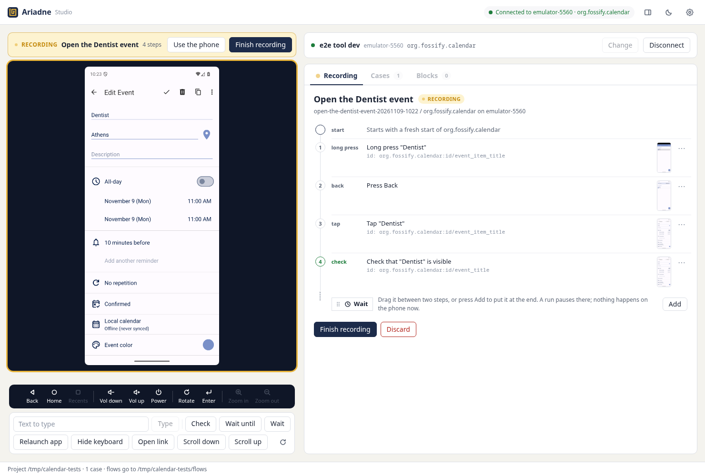

# Ariadne Studio

**Ariadne Studio, a recorder for Maestro.** A business analyst or product manager records
Android tests by using the app, and Ariadne writes plain Maestro YAML that runs on a laptop
and in CI. It runs on your own computer, with no account and no cloud service. Android only.



Every tap, swipe and key press becomes a step with a stable selector and a screenshot.
Reusable setup blocks (log in, skip onboarding) come from a form in the studio or from a developer's
editor, and developers review the generated flows in pull requests. The person who knows the product
gets a test case document (Excel, HTML or Markdown) that matches the flow exactly.

```yaml
appId: com.example.claims
name: Submit a claim
---
- launchApp
- tapOn:
    text: "Claims"
- inputText: "Rear bumper, parking lot"
- hideKeyboard
- tapOn:
    text: "Submit"
- assertVisible:
    text: "Claim submitted"
```

There is one file per case in `flows/`. Run it with `maestro test flows/<caseId>.yaml`
anywhere Maestro runs. Nothing in it needs Ariadne.

## Install

You need an Android emulator or a USB phone, and `adb` from the Android SDK platform-tools.
Run also needs the
[Maestro CLI](https://docs.maestro.dev/maestro-cli/how-to-install-maestro-cli) and Java 17 or
newer; recording works without them. **Device setup** in the studio checks all of this and
walks you through what is missing.

**Desktop app, for a BA or PM.** Download it from
[Releases](https://github.com/sudo-ezekiel/ariadne-studio/releases) and start it. It brings
its own Node and opens the project folder `Documents/Ariadne`. There is a Linux AppImage and a
Windows installer, and no macOS build yet. Nothing is code signed, so Windows SmartScreen warns
on first start: press More info, then Run anyway.

**npm package, for a developer.** Node 22.12 or newer:

```sh
npx ariadne-studio                    # this folder if it is a project, else its .ariadne project, else ./ariadne
npx ariadne-studio path/to/project    # or name the project folder
npx ariadne-studio init               # add Ariadne to the app repository you are in
```

It starts the studio on http://127.0.0.1:4711 and opens it in your browser.

## Your first case

1. Start the studio. In **Device**, pick your phone or emulator, enter the app id (such as
   `com.example.claims`) and press **Connect**. The screen appears.
2. In the **Record** tab, name the case and press **Start recording**. The app restarts, so
   the recording begins where a run will begin.
3. Use the app: click in the screen here, or use the phone itself with your fingers.
4. Toggle **Check** and click what must be visible, then toggle it off.
5. Press **Finish recording**, then **Save case**.
6. Open the case in the **Cases** tab and press **Run**. Each step shows passed or failed,
   with the recorded and replayed screens side by side.

The full walkthrough, on a real calendar app, is in
[Record your first case](apps/docs/guides/first-case.md).

## What runs on the phone, and why

Two things are installed on every phone automatically. Neither is part of your app.

| When | What | Why |
|---|---|---|
| Connect | agent-device's helper | Reads the screen and operates the phone while you record |
| Run | Maestro's driver | Runs the flow; Maestro installs its own, and only one driver can own a phone at a time |

Some makers ask on the phone's screen before an install, and the prompt can time out within
seconds, so watch the phone when you press **Connect** and **Run**. Xiaomi, Redmi and POCO
phones ask before every install, and need **Prepare this phone** in **Device setup** once
before their first run. See [Phone makers](apps/docs/guides/install.md#phone-makers) and
[SECURITY.md](SECURITY.md) for what these helpers can see.

## Phones

Ariadne has been tested with real fingers on one Xiaomi phone and over a remote link on one
Samsung phone. Everything else is unproven. Reports from other phones are the most useful
contribution right now: [Test on your phone](apps/docs/guides/test-on-your-phone.md) is the
checklist, and the [phone report](https://github.com/sudo-ezekiel/ariadne-studio/issues/new?template=phone_report.yml)
is where it goes.

| Phone | Status | Needs |
|---|---|---|
| Android emulator | Used for development and the smoke tests | Nothing extra |
| POCO F5 Pro, HyperOS 3 | Tested with real fingers | Install via USB, USB debugging (Security settings), **Prepare this phone** |
| Samsung Galaxy A16, One UI 6.1 | Tested over Samsung's Remote Test Lab: Connect, recording on the screen here and Run. Recording on the phone itself cannot work on a remote phone | Nothing extra there; on your own phone, look at **Auto Blocker** if commands fail |
| OPPO, Realme, OnePlus, vivo, iQOO, Huawei, Honor | Not tested | Maker switches, from other tools' docs and user reports |
| Google Pixel | Not tested | No extra switches known |
| Motorola, Nothing, Tecno, Infinix | Not tested | Nothing known either way |

## Limits

- Android only. No iOS.
- The desktop app is tested end to end on Linux. On real Windows, Connect, recording and Run have
  worked on one computer and one phone; typing, gestures and recording on the phone itself are not tried there
  yet. There is no macOS build yet.
- One device at a time. Run blocks the studio until Maestro finishes, with a limit of 5 minutes.
- Recording on the phone itself needs a phone you can touch. Gesture navigation is unproven on a real
  phone, and other phones report touches differently, so expect some to need work.
- A tap on a value that changes, such as a calculated result, fails on a later run.
- Screenshots and run videos keep whatever the screen showed. Keep `runs/` out of version
  control; a new project's `.gitignore` already does.

The full list is in [Known limits](apps/docs/reference/known-limits.md).

## Documentation

The source of the documentation is in `apps/docs`; `pnpm docs:dev` serves it locally.

- [Install and set up](apps/docs/guides/install.md)
- [Record your first case](apps/docs/guides/first-case.md)
- [Recording](apps/docs/guides/recording.md)
- [Setup blocks](apps/docs/guides/setup-blocks.md)
- [Run and Run all](apps/docs/guides/run.md)
- [Run in CI](apps/docs/guides/ci.md)
- [If you know Maestro](apps/docs/guides/if-you-know-maestro.md)
- [Troubleshooting](apps/docs/faq/troubleshooting.md)
- [CLI reference](apps/docs/reference/cli.md)

## Contribute

Bug reports, phone reports and pull requests are welcome. [CONTRIBUTING.md](CONTRIBUTING.md)
covers setup, tests and conventions, and [CODE_OF_CONDUCT.md](CODE_OF_CONDUCT.md) applies. To
report a vulnerability, see [SECURITY.md](SECURITY.md).

## Ariadne and Maestro

Ariadne writes and runs Maestro flows; it does not replace Maestro. Everything it records is
an ordinary flow, and setup blocks are ordinary flows you may already have. Maestro is a
trademark of mobile.dev. Ariadne is an independent tool and is not affiliated with mobile.dev.

## Licence

[Apache-2.0](LICENSE). Created in [T3 Code](https://t3.codes).
